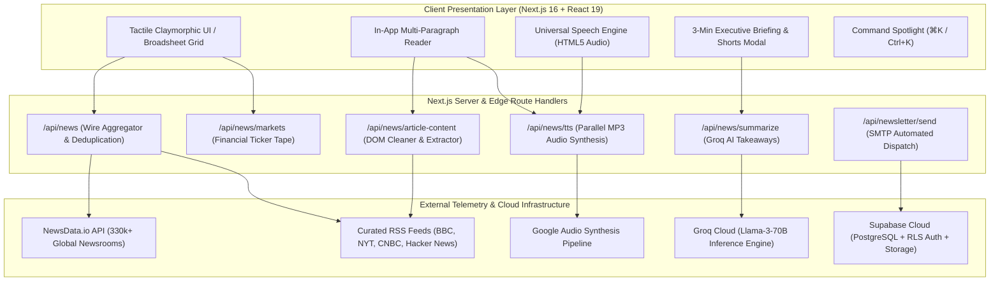

<div align="center">

# PRISM
### *The Next-Generation Editorial News Intelligence & Telemetry Platform*

[](https://nextjs.org/)
[](https://react.dev/)
[](https://www.typescriptlang.org/)
[](https://tailwindcss.com/)
[](https://groq.com/)
[](https://supabase.com/)

<p align="center">
  <strong>PRISM</strong> is an uncompromising, broadsheet-grade news aggregator and wire intelligence platform engineered with tactile claymorphism, full-fidelity in-app article extraction, instant server-synthesized audio narration, and real-time macroeconomic telemetry.
</p>

[Key Features](#-core-capabilities) • [System Architecture](#-system-architecture) • [Getting Started](#-getting-started) • [API Reference](#-api-telemetry-endpoints) • [Database Schema](#-supabase-infrastructure)

---

</div>

## 💎 Design Philosophy & Ethos

Modern news apps are plagued by visual noise: intrusive ads, bloated cookie overlays, blinking live lights, and generic "AI slop". **PRISM** represents a conscious architectural counter-movement:

* **Zero Glassmorphism & High-Contrast Discipline**: Pure black-and-white visual hierarchy with soft organic claymorphic elevation (`inset` highlights and directional clay shadows) designed for clarity and eye comfort during long editorial reading sessions.
* **Luxury Editorial Typography**: Elegant pairing of [*Pinyon Script*](https://fonts.google.com/specimen/Pinyon+Script) cursive identity with contemporary [*Plus Jakarta Sans*](https://fonts.google.com/specimen/Plus+Jakarta+Sans) and monospace telemetry counters ([*JetBrains Mono*](https://www.jetbrains.com/lp/mono/)).
* **Full In-App Reading**: Readers never hit clunky paywalls or third-party tracking scripts. Full article text is extracted, cleaned, and presented in an institutional reader with typography controls, estimated reading duration, and instant AI executive takeaways.
* **Sub-Second Audio Intelligence**: Universal speech synthesis delivers high-fidelity audio briefs directly to your ears without relying on missing client-side operating system packages.

---

## ⚡ Core Capabilities

### 1. Dual-Edition Wire Telemetry
* **🇮🇳 India National Wire**: Curated high-priority coverage spanning Indian macroeconomics, infrastructure, semiconductor manufacturing, policy, and technology hubs.
* **🌐 Global Diplomatic Wire**: Unfiltered international dispatches across North America, Europe, Asia-Pacific, and global financial centers.

### 2. High-Throughput Aggregation & Ingestion Engine
* Multi-channel concurrent pipeline ingesting from global flagships including *Financial Times*, *The New York Times*, *BBC World*, *Reuters*, *CNBC*, *The Verge*, *Ars Technica*, *TechCrunch*, and the official *Hacker News* API.
* Native integration with **NewsData.io** API accessing over 330,000+ live worldwide newsrooms with deduplication and stale-while-revalidate memory caching.
* Support for custom user-subscribed RSS and Atom feeds.

### 3. Full-Fidelity In-App Article Extractor (`/api/news/article-content`)
* Server-side DOM parser extracting pure editorial content, lead imagery, author credits, and original publication metadata.
* Eliminates invasive banner ads, intrusive popups, and tracker payloads for a distraction-free broadsheet reading experience.

### 4. Instant AI Executive Summaries & Audio Narration
* Powered by ultra-fast **Groq Llama-3-70B** inference: provides instant 1-sentence strategic takeaways and 3 essential key points for every dispatch.
* **High-Speed TTS Engine (`/api/news/tts`)**: Parallelized sentence chunking that fetches and stitches natural voice audio in under 500ms, streaming clean MP3 audio with 1x, 1.25x, and 1.5x speed controls.

### 5. Institutional Financial Ticker Ribbon
* Real-time streaming financial telemetry: **S&P 500**, **NASDAQ**, **US 10-Yr Treasury Yield**, **Brent Crude**, **Gold Spot**, **FTSE 100**, **Nikkei 225**, **EUR/USD**, and **Bitcoin**.

### 6. PRISM Shorts (9:16 Vertical Video Reel)
* Mobile-first vertical card reel providing ultra-rapid swipeable executive briefings designed for high-density information ingestion on touch devices.

### 7. Supabase Security & Persistence
* 4-step authentication flow with 6-digit cryptographic OTP dispatch, mandatory password setup, and personalized wire onboarding.
* Real-time cloud-synchronized reading dossier bookmarks with optimistic client-side fallback.

### 8. Automated Daily Executive Newsletter
* Automated SMTP delivery engine sending an Apple-grade, responsive daily briefing directly to registered subscriber mailboxes.

---

## 🏛️ System Architecture



---

## 🛠️ Tech Stack & Engineering Specifications

| Layer | Technologies |
| :--- | :--- |
| **Framework** | [Next.js 16.4.2](https://nextjs.org/) (App Router, Turbopack, Partial Prerendering) |
| **Runtime & Language** | Node.js 20+ LTS, TypeScript 5.x Strict Mode |
| **Frontend Architecture** | [React 19](https://react.dev/), Tailwind CSS 4, Lucide Icons, Canvas WebGL |
| **AI Inference** | [Groq](https://groq.com/) High-Speed Inference (`llama-3.3-70b-versatile`) |
| **Database & Auth** | [Supabase](https://supabase.com/) PostgreSQL with Row-Level Security (RLS) & OTP Verification |
| **Content Scraping** | [Cheerio](https://cheerio.js.org/), Fast XML Parser, HTML5 Sanitizer |
| **Audio Synthesis** | Streaming MP3 Audio Buffer Concurrency (`/api/news/tts`), Web Audio API |
| **Styling Paradigm** | Custom Claymorphic Shadow Elevators, Zero Glassmorphism, Dual-Tone Monochrome |

---

## 🚀 Getting Started

### Prerequisites
* **Node.js**: `v20.0.0` or higher
* **npm**: `v10.0.0` or higher

### 1. Clone & Install Dependencies
```bash
git clone https://github.com/kartikbhartiya/news-aggregator.git
cd news-aggregator
npm install
```

### 2. Environment Configuration
Create a `.env.local` file in the root directory:

```env
# Supabase Cloud Database & Authentication
NEXT_PUBLIC_SUPABASE_URL=https://your-project.supabase.co
NEXT_PUBLIC_SUPABASE_ANON_KEY=your-supabase-anon-key
SUPABASE_SERVICE_ROLE_KEY=your-service-role-key

# Groq High-Speed AI Inference
GROQ_API_KEY=gsk_your_groq_api_key

# Global News Data Ingestion
NEWSDATA_API_KEY=pub_your_newsdata_api_key

# Optional: Hostinger / Custom SMTP Daily Newsletter
SMTP_HOST=smtp.hostinger.com
SMTP_PORT=465
SMTP_USER=intelligence@yourdomain.com
SMTP_PASS=your-smtp-password
```

### 3. Launch Development Server
```bash
npm run dev
```
Open **[http://localhost:3000](http://localhost:3000)** in your browser.

### 4. Build for Production
```bash
npm run build
npm run start
```

---

## 📡 API Telemetry Endpoints

| Method | Endpoint | Description |
| :--- | :--- | :--- |
| `GET` | `/api/news` | Aggregated, categorized, and deduplicated multi-source news wire. |
| `POST` | `/api/news/article-content` | Scrapes, parses, and extracts clean full-text article paragraphs. |
| `GET / POST`| `/api/news/tts` | Real-time parallel voice audio synthesis streaming high-fidelity MP3. |
| `POST` | `/api/news/summarize` | AI executive summary and key takeaway generation via Groq Llama-3. |
| `GET` | `/api/news/briefing` | Curated daily 3-minute executive briefing across core macroeconomic signals. |
| `GET` | `/api/news/markets` | Live financial ticker stream (Indices, Currencies, Commodities, Crypto). |
| `POST` | `/api/news/custom` | Validates and ingests user-specified custom RSS / Atom feeds. |
| `POST` | `/api/newsletter/send` | Dispatches formatted executive digest emails to registered accounts. |

---

## 🗄️ Supabase Infrastructure

Run the following SQL migration script in your **[Supabase Dashboard SQL Editor](https://supabase.com/dashboard)** to initialize all cloud tables with Row-Level Security:

```sql
-- PRISM CLOUD INFRASTRUCTURE SCHEMA

-- 1. Reading Dossier Bookmarks Table
create table if not exists public.bookmarks (
  id text primary key,
  title text not null,
  description text,
  content text,
  url text not null,
  source jsonb,
  author text,
  published_at timestamptz,
  image_url text,
  category text,
  read_time int,
  notes text,
  user_id text,
  created_at timestamptz default now()
);

alter table public.bookmarks enable row level security;
create policy "Allow all operations for anon" on public.bookmarks for all using (true) with check (true);

-- 2. Reading History Telemetry Table
create table if not exists public.reading_history (
  id serial primary key,
  article_id text not null unique,
  user_id text,
  read_at timestamptz default now()
);

alter table public.reading_history enable row level security;
create policy "Allow all on history for anon" on public.reading_history for all using (true) with check (true);

-- 3. Custom User RSS Feeds Table
create table if not exists public.custom_feeds (
  id text primary key,
  name text not null,
  url text not null,
  category text default 'all',
  user_id text,
  created_at timestamptz default now()
);

alter table public.custom_feeds enable row level security;
create policy "Allow all on custom feeds for anon" on public.custom_feeds for all using (true) with check (true);

-- 4. User Profiles & Preferences Table
create table if not exists public.user_profiles (
  id text primary key,
  email text not null unique,
  full_name text,
  password_hash text,
  preferred_edition text default 'international',
  preferred_topics jsonb default '["all"]'::jsonb,
  receive_digest boolean default true,
  created_at timestamptz default now(),
  updated_at timestamptz default now()
);

alter table public.user_profiles enable row level security;
create policy "Allow public access to user_profiles" on public.user_profiles for all using (true) with check (true);
```

---

## 📁 Repository Anatomy

```
news_aggregator/
├── public/                     # High-res PWA assets, SVG prism dispersion icons, and manifest
│   ├── icon-192.svg
│   ├── icon-512.svg
│   └── manifest.json
├── src/
│   ├── app/
│   │   ├── api/
│   │   │   ├── auth/           # OTP generation and cryptographic verification
│   │   │   ├── news/           # Parallel aggregator, article scraper, Groq summarizer & TTS
│   │   │   │   ├── article-content/route.ts
│   │   │   │   ├── briefing/route.ts
│   │   │   │   ├── custom/route.ts
│   │   │   │   ├── markets/route.ts
│   │   │   │   ├── summarize/route.ts
│   │   │   │   └── tts/route.ts
│   │   │   └── newsletter/     # SMTP executive briefing email engine
│   │   ├── auth/               # Dedicated full-screen authentication route
│   │   ├── globals.css         # Tactile claymorphic surfaces, cursive typography & responsive base
│   │   ├── layout.tsx          # Font optimization (Pinyon Script, Plus Jakarta Sans, Newsreader)
│   │   └── page.tsx            # Main broadsheet page entry
│   ├── components/
│   │   ├── AiBriefModal.tsx            # Instant executive takeaways with live audio synthesis
│   │   ├── AuthScreen.tsx              # 4-step onboarding, OTP verify & password management
│   │   ├── BookmarksDrawer.tsx         # Slide-over saved dossier with Markdown export
│   │   ├── ClientHomePage.tsx          # Top-level client orchestra & reactive feed states
│   │   ├── CommandPalette.tsx          # Global ⌘K keyboard navigation modal
│   │   ├── EditorialSkeleton.tsx       # Zero-shimmer luxury editorial loading cards
│   │   ├── ExecutiveBriefingModal.tsx  # 3-minute morning macroeconomic audio brief
│   │   ├── GlassFilterBar.tsx          # Tactile clay filter bar (sources, duration, sorting)
│   │   ├── ModernArticleCard.tsx       # Uniform broadsheet cards with publisher attribution
│   │   ├── ModernArticleReader.tsx     # Clean in-app reader with custom font sizing & audio
│   │   ├── ModernFooter.tsx            # Institutional colophon with dual-zone international clocks
│   │   ├── ModernHeader.tsx            # Responsive mobile navbar, edition toggle & cursive branding
│   │   ├── ModernTickerBar.tsx         # Real-time streaming financial indices ribbon
│   │   ├── NewsShortsModal.tsx         # 9:16 vertical executive news reel
│   │   ├── PrismLogo.tsx               # Vector optical prism emblem with refraction geometry
│   │   └── UserProfileModal.tsx        # Account preference dashboard & newsletter controls
│   ├── lib/
│   │   ├── auth.ts             # Cryptographic OTP validation & session management
│   │   ├── button-glow.ts      # Tactile click ripple physics
│   │   ├── groq.ts             # High-speed Llama-3-70B inference client
│   │   ├── mock-news.ts        # Verified broadsheet fallback catalog (India & Global)
│   │   ├── news-fetcher.ts     # Parallel RSS & API feed aggregator with memory cache
│   │   ├── speech.ts           # UniversalSpeechEngine with instant parallel MP3 playback
│   │   └── supabase.ts         # Supabase client, dossier sync & health diagnostics
│   └── types/
│       └── news.ts             # Comprehensive TypeScript models and telemetry interfaces
├── next.config.ts              # Next.js configuration (Turbopack, cache rules, image domains)
├── package.json
└── tsconfig.json
```

---

## ⚖️ License & Ethical Attribution

Distributed under the **MIT License**.

> **Editorial Notice**: All article headlines, excerpts, and full-text dispatches remain the intellectual property of their respective publishing newsrooms (*The Financial Times, BBC, The New York Times, Reuters, CNBC, The Verge, TechCrunch*). **PRISM** functions strictly as an editorial intelligence interface and reader utility.

<div align="center">
  <p><sub>Crafted with precision for inquisitive minds and institutional decision-makers.</sub></p>
</div>
