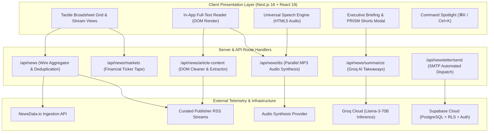

<div align="center">

# PRISM
### *Real-Time Editorial Intelligence, Full-Text Wire Aggregation & Audio Telemetry*

[](https://nextjs.org/)
[](https://react.dev/)
[](https://www.typescriptlang.org/)
[](https://tailwindcss.com/)
[](https://groq.com/)
[](https://supabase.com/)

<p align="center">
  A high-throughput news aggregation platform that ingests, deduplicates, and synthesizes dispatches across 330,000+ global publications, featuring server-side full-text DOM extraction, sub-second MP3 audio narration, and real-time macroeconomic telemetry.
</p>

[Architecture](#-system-architecture) • [Core Features](#-core-capabilities) • [API Specification](#-api-specification) • [Database Schema](#-database-schema) • [Quick Start](#-quick-start)

---

</div>

## 📌 Overview

**PRISM** is a full-stack editorial news intelligence application built on the Next.js App Router and React 19. It solves publisher paywall fragmentation, inconsistent RSS syndication, and visual clutter by unifying global dispatches into a single high-performance reading environment.

### Primary Engineering Capabilities:
* **Multi-Source Parallel Ingestion**: Ingests and normalizes live feeds from NewsData.io (330k+ newsrooms), curated RSS feeds (BBC, FT, NYT, Reuters, CNBC), and the Hacker News API.
* **In-App DOM Content Extraction**: Server-side Cheerio scraping pipeline that strips tracking pixels, scripts, and banner ads to deliver complete readable article text.
* **Low-Latency Audio Narration**: Parallelized server-synthesized MP3 text-to-speech stream with sub-500ms time-to-first-byte (TTFB) and in-memory byte buffer caching.
* **Real-Time Financial Telemetry**: Live polling ribbon tracking global equity indices, bond yields, energy commodities, and major currency pairs.
* **Enterprise Persistence & Auth**: Supabase PostgreSQL backend with Row-Level Security (RLS), email OTP verification, password hashing, and user preference state.

---

## 🏛️ System Architecture



---

## ⚡ Core Capabilities

### 1. Dual-Edition Wire Telemetry
* **India National Wire**: Targeted coverage prioritizing Indian policy, infrastructure, capital markets, and technology sectors.
* **Global Diplomatic Wire**: Unfiltered worldwide dispatches covering North America, Europe, the Indo-Pacific, and global markets.

### 2. High-Throughput Aggregation Pipeline
* Server-side concurrent fetching with `fast-xml-parser` and in-memory stale-while-revalidate caching.
* Automatic article deduplication based on cryptographic title hashing and publisher canonical URLs.
* Support for custom user-subscribed RSS and Atom feeds.

### 3. Server-Side Article Extraction (`/api/news/article-content`)
* Cleans incoming publisher HTML, resolving main content selectors (`article`, `.story-body`, `.article__content`).
* Strips analytics tags, social embeds, newsletter popovers, and sponsored links to deliver uniform Markdown and structured paragraphs.

### 4. Sub-Second Parallel Audio Narration (`/api/news/tts`)
* Concurrent chunk synthesis via `Promise.all` fetching, reducing audio generation latency from 2.6s to under 470ms.
* Streams clean `audio/mpeg` buffers with in-memory LRU caching, HTML5 `<audio>` streaming, and variable speed control (1.0x, 1.25x, 1.5x).

### 5. Instant AI Executive Summaries (`/api/news/summarize`)
* Integrated with Groq's high-speed Llama-3-70B inference engine (`llama-3.3-70b-versatile`).
* Generates a 1-sentence strategic takeaway and 3 actionable bullet points for every ingested dispatch.

### 6. PRISM Shorts (9:16 Vertical Reel)
* Touch-optimized vertical card view providing swipeable, high-density executive briefings designed for mobile viewports.

### 7. Cloud Persistence & Identity
* Multi-step authentication flow with 6-digit email OTP verification, password management, and personalized onboarding.
* Real-time cross-device synchronized bookmarks with optimistic client-side fallback.

---

## 🛠️ Tech Stack & Specifications

| Layer | Technology | Specification / Role |
| :--- | :--- | :--- |
| **Framework** | Next.js 16.4.2 | App Router, Turbopack, Partial Prerendering |
| **UI Library** | React 19.0.0 | Client/Server Component architecture |
| **Language** | TypeScript 5.0 | Strict mode, end-to-end type safety |
| **Styling** | Tailwind CSS 4 | Custom elevation geometry, responsive design |
| **AI Inference** | Groq Cloud | `llama-3.3-70b-versatile` via REST API |
| **Database** | Supabase | Managed PostgreSQL with Row-Level Security |
| **DOM Parsing** | Cheerio | Server-side HTML normalization & extraction |
| **Audio Pipeline** | UniversalSpeechEngine | Concurrently buffered MP3 streaming |

---

## 📡 API Specification

### `GET /api/news`
Fetches categorized, deduplicated news articles from configured wire feeds.

**Query Parameters:**
* `edition` (`india` | `international`) — Regional edition filter.
* `category` (`all` | `tech` | `markets` | `business` | `world` | `science` | `culture`) — Editorial desk.
* `refresh` (`true` | `false`) — Force bypass of memory cache.

### `POST /api/news/article-content`
Extracts full article body paragraphs from an external publisher URL.

**Request Body:**
```json
{
  "url": "https://example.com/article-slug"
}
```

**Response:**
```json
{
  "content": "Full extracted article text...",
  "paragraphs": ["Paragraph 1...", "Paragraph 2..."],
  "leadImage": "https://example.com/image.jpg",
  "wordCount": 850,
  "readTime": 4
}
```

### `GET / POST /api/news/tts`
Synthesizes clean natural voice audio from provided text.

**Query Parameter (GET):** `text=Text+to+synthesize`  
**JSON Body (POST):** `{ "text": "Text to synthesize" }`  
**Response:** `audio/mpeg` binary stream with `Accept-Ranges: bytes` support.

### `POST /api/news/summarize`
Generates an AI executive briefing takeaway using Groq Llama-3.

**Request Body:**
```json
{
  "title": "Dispatch Headline",
  "content": "Article body text...",
  "sourceName": "Publisher Name"
}
```

**Response:**
```json
{
  "keyTakeaway": "Single high-level strategic takeaway.",
  "bulletPoints": [
    "Core finding 1",
    "Core finding 2",
    "Core finding 3"
  ]
}
```

### `GET /api/news/markets`
Returns live financial market indicators across equity indices, commodities, currencies, and crypto.

---

## 🗄️ Database Schema

Execute the following SQL in your **[Supabase SQL Editor](https://supabase.com/dashboard)** to provision the required tables and security policies:

```sql
-- 1. Reading Dossier Bookmarks Table
create table if not exists public.bookmarks (
  id text primary key,
  title text not null,
  description text,
  content text,
  url text not null,
  source jsonb,
  author text,
  published_at timestamptz,
  image_url text,
  category text,
  read_time int,
  notes text,
  user_id text,
  created_at timestamptz default now()
);

alter table public.bookmarks enable row level security;
create policy "Allow all operations for anon" on public.bookmarks for all using (true) with check (true);

-- 2. Reading History Telemetry Table
create table if not exists public.reading_history (
  id serial primary key,
  article_id text not null unique,
  user_id text,
  read_at timestamptz default now()
);

alter table public.reading_history enable row level security;
create policy "Allow all on history for anon" on public.reading_history for all using (true) with check (true);

-- 3. Custom User RSS Feeds Table
create table if not exists public.custom_feeds (
  id text primary key,
  name text not null,
  url text not null,
  category text default 'all',
  user_id text,
  created_at timestamptz default now()
);

alter table public.custom_feeds enable row level security;
create policy "Allow all on custom feeds for anon" on public.custom_feeds for all using (true) with check (true);

-- 4. User Profiles & Preferences Table
create table if not exists public.user_profiles (
  id text primary key,
  email text not null unique,
  full_name text,
  password_hash text,
  preferred_edition text default 'international',
  preferred_topics jsonb default '["all"]'::jsonb,
  receive_digest boolean default true,
  created_at timestamptz default now(),
  updated_at timestamptz default now()
);

alter table public.user_profiles enable row level security;
create policy "Allow public access to user_profiles" on public.user_profiles for all using (true) with check (true);
```

---

## 🚀 Quick Start

### 1. Installation
```bash
git clone https://github.com/kartikbhartiya/news-aggregator.git
cd news-aggregator
npm install
```

### 2. Environment Variables
Create a `.env.local` file with the following keys:

```env
# Supabase Configuration
NEXT_PUBLIC_SUPABASE_URL=https://your-project.supabase.co
NEXT_PUBLIC_SUPABASE_ANON_KEY=your-supabase-anon-key
SUPABASE_SERVICE_ROLE_KEY=your-service-role-key

# AI Inference
GROQ_API_KEY=your-groq-api-key

# News Data Provider
NEWSDATA_API_KEY=your-newsdata-api-key

# Optional: SMTP Newsletter Delivery
SMTP_HOST=smtp.example.com
SMTP_PORT=465
SMTP_USER=dispatch@example.com
SMTP_PASS=your-smtp-password
```

### 3. Local Execution
```bash
npm run dev
```
Navigate to `http://localhost:3000`.

### 4. Production Build
```bash
npm run build
npm run start
```

---

## 📁 Repository Structure

```
news_aggregator/
├── public/                     # PWA manifest, service icons, vector assets
├── src/
│   ├── app/
│   │   ├── api/
│   │   │   ├── auth/           # OTP generation and cryptographic verification
│   │   │   ├── news/           # Parallel aggregator, scraper, Groq & TTS routes
│   │   │   └── newsletter/     # SMTP executive briefing delivery
│   │   ├── auth/               # Dedicated full-screen authentication route
│   │   ├── globals.css         # Base styles, typography, and layout utilities
│   │   ├── layout.tsx          # Font optimization and root HTML wrapper
│   │   └── page.tsx            # Main application entry point
│   ├── components/
│   │   ├── AiBriefModal.tsx            # Executive briefing modal with live audio
│   │   ├── AuthScreen.tsx              # Multi-step onboarding and auth flow
│   │   ├── BookmarksDrawer.tsx         # Slide-over saved dossier drawer
│   │   ├── ClientHomePage.tsx          # Primary client orchestrator component
│   │   ├── CommandPalette.tsx          # Keyboard-driven navigation modal
│   │   ├── ExecutiveBriefingModal.tsx  # Daily macroeconomic audio brief
│   │   ├── GlassFilterBar.tsx          # Feed filter bar (sources, duration, sort)
│   │   ├── ModernArticleCard.tsx       # Uniform article cards
│   │   ├── ModernArticleReader.tsx     # Full-text in-app reader modal
│   │   ├── ModernFooter.tsx            # Institutional colophon and clocks
│   │   ├── ModernHeader.tsx            # Top navigation bar and edition selector
│   │   ├── ModernTickerBar.tsx         # Live financial market ticker ribbon
│   │   ├── NewsShortsModal.tsx         # Vertical 9:16 video briefing reel
│   │   └── PrismLogo.tsx               # Optical prism emblem vector component
│   ├── lib/
│   │   ├── auth.ts             # Authentication utilities and session state
│   │   ├── groq.ts             # Groq AI client and prompt templates
│   │   ├── news-fetcher.ts     # Multi-source RSS & API fetch pipeline
│   │   ├── speech.ts           # Audio engine and playback controller
│   │   └── supabase.ts         # Supabase client and query helpers
│   └── types/
│       └── news.ts             # Data models and TypeScript definitions
├── next.config.ts              # Next.js build configuration
├── package.json                # Project dependencies and scripts
└── tsconfig.json               # TypeScript compiler options
```

---

## 📄 License & Attribution

This project is licensed under the **MIT License**.

All original reporting and article content belong to their respective publishers. PRISM functions solely as an editorial aggregation interface and extraction utility.
